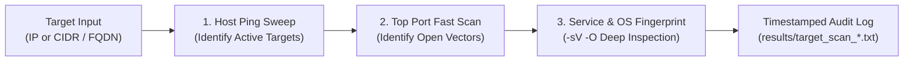

# 🌐 NetSweep: Automated Network Reconnaissance Pipeline

> **Lightweight Bash Pipeline Wrapping Nmap for Automated Network Discovery & Penetration Testing Recon**  
> Streamlined host ping discovery, multi-stage port scanning, service version fingerprinting, and automated forensic logging.

<p align="center">
  
  
  
  
</p>

---

## ⚡ Overview

During penetration testing and security audits, manual Nmap execution across multiple stages (host discovery, top ports, full banner grab, OS fingerprinting) is repetitive and prone to missing output persistence.

**NetSweep** standardizes network reconnaissance into an automated Bash pipeline that validates inputs, creates timestamped forensic audit logs in a structured `results/` directory, and performs systematic multi-phase host scanning.

---

## 🛠️ Reconnaissance Stages



---

## 🚀 Usage & Execution

### Prerequisites
Ensure `nmap` and `bash` are installed on your system:
```bash
# Ubuntu / Debian
sudo apt update && sudo apt install -y nmap

# macOS (Homebrew)
brew install nmap
```

### Run NetSweep
```bash
git clone https://github.com/krishujeniya/NetSweep.git
cd NetSweep
chmod +x Scan.sh
./Scan.sh
```

### Example Interactive Session
```text
=== Automated Network Scanner ===
Enter target IP or domain: 192.168.1.1
Starting scan on 192.168.1.1...
Results will be saved to results/192_168_1_1_scan_20261102_120000.txt

[Phase 1] Performing host discovery ping sweep...
[Phase 2] Scanning common TCP/UDP service ports...
[Phase 3] Fingerprinting service versions and OS signatures...
[✓] Scan complete. Output persisted to results/192_168_1_1_scan_20261102_120000.txt
```

---

## 📁 Repository Structure

```
├── Scan.sh         # Executable bash network reconnaissance pipeline
├── results/        # Automated output directory for scan reports (git-ignored)
├── LICENSE         # MIT Open-Source License
└── README.md       # Technical documentation
```

---

## 📄 License & Legal Notice

Distributed under the [MIT License](LICENSE). 

> **Disclaimer**: This tool is designed strictly for authorized penetration testing, internal infrastructure auditing, and educational security research. Unauthorized scanning of third-party networks without explicit consent is illegal.
